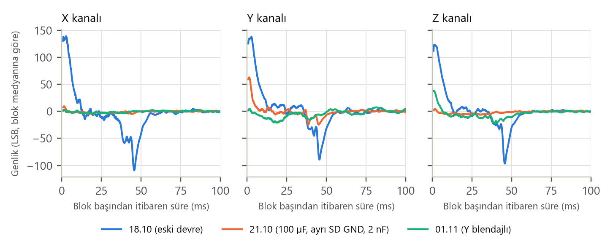
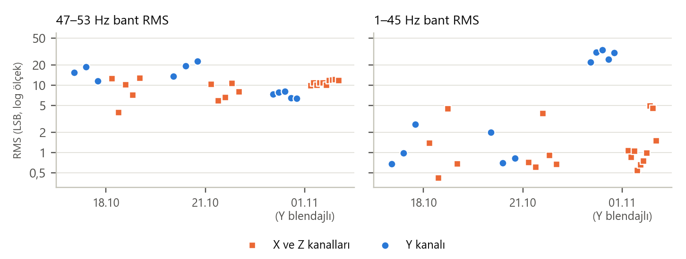

# 03.11.2026: ilk paket ve 18.10–01.11 kayıtları

Bu klasör, 2. dönemin ilk GitHub paketidir (03.11.2026). Daha önce ana klasörde dağınık duran dosyalar buraya toplandı; içerikleri değişmedi.

| Yer | İçerik |
|---|---|
| `Piezo_KaraKutu_2026-11-03.zip` | O günkü firmware projesi (SPI kapısı yok), `Docs/` (Mayıs 2026 raporu, Ekim 2026 inceleme PDF'i) ve `analiz/analiz.py` |
| [VsCodeda_Piezo_Ornek_ve_Analiz/](VsCodeda_Piezo_Ornek_ve_Analiz/) | 18.10, 21.10 ve 01.11 kayıtları, WAV dosyaları, okuma betikleri; her kayıt klasöründe o günü anlatan README |
| [grafikler/](grafikler/) | Aşamalara göre SD darbesi ve bant RMS grafikleri (aşağıdaki tablo) |
| [fotograflar/](fotograflar/) | Breadboard, blendajlı piezolar ve hoparlör düzeneği |

## Firmware değişiklikleri (Ekim 2026)

Ayrıntılar zip'teki `Docs/Uc_Piezolu_SD_Kaydedici_Incelemesi.pdf` dosyasında.

- Sessiz blok kaybına yol açan bayrak yarışı giderildi, kayıp bloklar `overrun_count` ile sayılıyor.
- Tampon 48 KB oldu, `f_sync` yaklaşık 0,8 s'de bir çalışıyor.
- Yazma hatası, kart dolması ve ADC durması algılanıyor.
- Mavi düğmeyle kayıt durdurulup başlatılabiliyor, her kayıt yeni bir `PIEZOnnn.BIN` dosyasına yazılıyor.
- SD kart 328 kHz'te başlatılıp 10,5 MHz'e geçiyor.
- X kanalı PA0'dan PA3'e taşındı.

## Donanım ve analiz (18.10 – 03.11.2026)

Devre ayrıntıları ana klasördeki [AFE_DEGISIKLIKLERI.md](../AFE_DEGISIKLIKLERI.md) dosyasında.

1. Kayıtlardaki "spike" seslerinin kaynağı SD yazmaları olarak belirlendi. Bozulma, yazmanın başladığı her bloğun ilk ~40 ms'inde görülüyor.
2. Veri kaybı olmadığı doğrulandı: 100 Hz tonun fazı blok sınırlarında sürekli kaldı. Sapma 0,08 rad'ın altındaydı; bir blok kaybolsaydı yaklaşık 0,25 rad atlama görülürdü.
3. Ön kat kapasitörleri ve topraklama düzenlendi. SD yazmasının yarattığı yavaş darbe X ve Z kanallarında yaklaşık 10 kat azaldı.
4. Y kanalına blendajlı kablo takıldı. 50 Hz bandı yaklaşık 2–3 kat düştü, ancak düşük frekans gürültüsü arttı. Ayrıntılar [01.11 kayıtlarının açıklamasında](<VsCodeda_Piezo_Ornek_ve_Analiz/01 11 26 blendajlı piezo Y ekseni/README.md>).
5. Blendajlı kablo X ve Z piezolarına da lehimlendi.

## Ölçüm sonuçları (masa testleri, 18.10 – 16.11)

Sessiz bloklarda, kayıtlardan hesaplanmıştır. 1 LSB ≈ 0,717 mV. 16.11 sütunları [SPI kapısı testinden](<../16 11 26 SPI kapısı güncellemesi/README.md>) gelir: "kapı 0" kapının kapalı, "kapı 1" açık olduğu kayıtlar.

| Metrik | Kanal | 18.10 | 21.10 | 01.11 | 16.11 kapı 0 | 16.11 kapı 1 |
|---|---|---|---|---|---|---|
| SD yavaş darbe, tepe-tepe (LSB) | X | 154–248 | 14–24 | zincire bağlı* | 7–11 | **5** |
| | Y | 149–228 | 64–88 | 18–50 | 7–12 | **4–5** |
| | Z | 217–540 | 2–15 | zincire bağlı* | 8–11 | **4–5** |
| Tek örnekli çatırtı, yazma penceresi ortalaması (LSB) | X | 30–36 | 18–21 | 17–20 | 15–20 | **2,6–2,7** |
| | Y | 13–19 | 19–24 | 14–17 | 20–24 | **2,9–3,0** |
| | Z | 12–15** | 13–22 | 16–19 | 21–25 | **2,9** |
| 47–53 Hz bant RMS (LSB) | Y | 12–19 | 13–23 | 6–8 | 2,3–2,7 | 2,4–2,5 |
| 1–45 Hz bant RMS (LSB) | Y | 0,7–2,6 | 0,7–2,0 | **22–34** | 0,7–0,8 | 0,5–0,7 |

\* 01.11'de X ve Z kabloları bazı kayıtlarda çaprazlandı. Darbe kanalı değil kablo zincirini izledi: hoparlördeki zincirde 8–16, klavyedeki zincirde 52–68 LSB.
\*\* 18.10 sweep kaydı hariç. O kayıtta Z kanalı anormaldi (119 LSB) ve kırpılma vardı.

Bloğun sakin bölümündeki çatırtı her aşamada yaklaşık 3 LSB. 16.11'de kapı açıkken yazma penceresi de bu seviyeye indi.

Bu değerler hoparlör ve klavye üzerindeki masa testlerinden alındı. Aynı aşamada birden fazla değişiklik yapıldığı için iyileşmeler tek bir nedene bağlanamaz.

## Sayıları yeniden üretme

- 18.10–01.11 değerleri zip'teki `analiz/analiz.py` ile üretildi. Çalıştırmadan önce betikteki `KOK` yolunu bu klasördeki `VsCodeda_Piezo_Ornek_ve_Analiz/` klasörüne göre değiştirin.
- 16.11 değerleri 16.11 zip'indeki `analiz/kapi_analiz.py` ve `analiz/kapi_sayim.py` ile üretildi.

**Eski rapor:** zip'teki Mayıs 2026 raporu eski tasarımı anlatır: TL084, 3,3 V ve PA0 gibi bilgiler güncel değildir.
