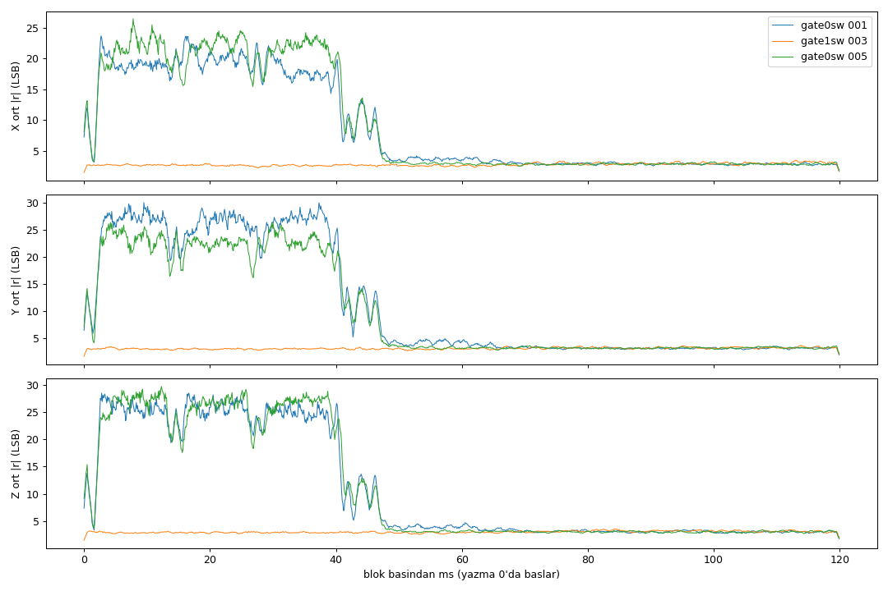
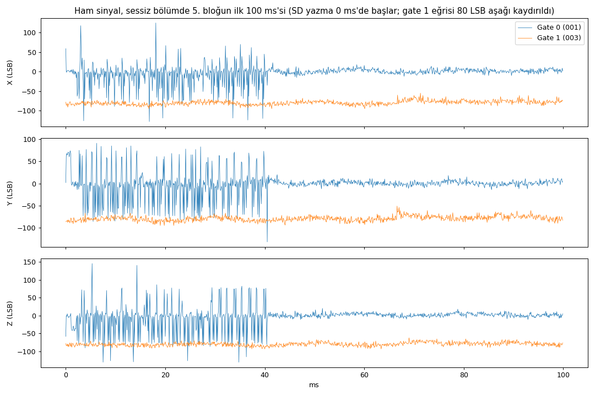

# 16.11.2026 güncellemesi: SPI kapısı ve üç blendajlı piezo

Bu klasör 16.11.2026 güncellemesini içeriyor:

- SD yazması sırasındaki çatırtıyı gideren firmware değişikliği (SPI kapısı)
- Bu değişikliği sınayan A/B testi
- Üç piezonun da blendajlı kabloyla bağlandığı ilk kayıtlar

Daha önceki çalışmalar bir üst klasördeki [README](../README.md) dosyasında anlatılıyor.

## İçerik

| Dosya | Açıklama |
|---|---|
| [Piezo_KaraKutu_2026-11-16.zip](Piezo_KaraKutu_2026-11-16.zip) | Güncel firmware projesi (SPI kapısı açık), belgeler ve analiz betikleri. 03.11 zip'inin yerini alır. |
| [kayitlar/](kayitlar/) | 6 ham kayıt (`.BIN`) ve her kayıt ve eksen için WAV |
| [grafikler/](grafikler/) | Kapı açık ve kapalı karşılaştırma grafikleri |
| [duzenek_uc_blendajli_hoparlor.jpg](duzenek_uc_blendajli_hoparlor.jpg) | Test düzeni |

## Firmware değişikliği: SPI kapısı

Değişiklik danışman Emin Germen'den geldi (03.11.2026). Yalnızca `defines.h`, `tm_stm32_spi.h` ve `tm_stm32_spi.c` dosyaları değişti.

- SPI1, ADC'nin 3 kanallı taraması sürerken (~22 µs) bayt göndermiyor. TIM3 mikrosaniye sayıyor ve bir bayt yalnızca sayaç 25–97 µs aralığındayken başlıyor. Böylece ADC örnekleme yaparken SPI saati (SCK) sessiz kalıyor.
- Özellik `defines.h` içindeki `TM_SPI1_ADC_GATE` ile açılıp kapatılıyor (1 = açık, 0 = kapalı). Zip'teki projede açık.
- TIM3 dururken, yani SD kart bağlanırken ve dosya kapatılırken, kapı devre dışı kalıyor.

## Test düzeni

- Üç blendajlı piezo hoparlörün alt düz yüzeyinde yan yana duruyor. Bant kullanılmadı; piezolar önceki kayıtlarda olduğu gibi eski yapışkan kalıntısıyla tutunuyor. Pirinç yüzleri hoparlöre bakıyor.
- Breadboard'a giden açık giriş telleri 2–3 cm'ye kısaltıldı. Üç blendaj tek bir GND noktasına bağlı.
- AFE: TL074CN, 9 V pil, Rf 8 MΩ ∥ Cf 470 pF.
- Kayıtlar boyunca düzene dokunulmadı. Kayıtlar arasında yalnızca kapı ayarı değişti.

## Kayıtlar

| Dosya | Kapı | Sinyal | Süre |
|---|---|---|---|
| `gate0swPIEZO001.BIN` | Kapalı (0) | 10 s sessiz + sweep + 10 s sessiz | 29,6 s |
| `gate0100hzPIEZO002.BIN` | Kapalı (0) | ~12 s sessiz + ~8 s 100 Hz + sessiz | 29,9 s |
| `gate1swPIEZO003.BIN` | Açık (1) | 10 s sessiz + sweep + 10 s sessiz | 28,9 s |
| `gate1100hzPIEZO004.BIN` | Açık (1) | ~12 s sessiz + ~11 s 100 Hz + sessiz | 32,8 s |
| `gate0swPIEZO005.BIN` | Kapalı (0) | 10 s sessiz + sweep + 10 s sessiz | 26,9 s |
| `gate0100hzPIEZO006.BIN` | Kapalı (0) | ~14 s sessiz + ~14 s 100 Hz + sessiz | 40,5 s |

- 100 Hz kayıtları sweep kayıtlarından daha yüksek seste alındı. Aynı tür kayıtlar kendi aralarında aynı seste.
- Sona ikinci bir kapı kapalı turu eklendi. Amacı, test boyunca düzenin değişmediğini göstermek.
- **WAV dosyaları:** `*_X.wav`, `*_Y.wav`, `*_Z.wav`; 10 kHz, 16 bit. `sesdonusturme.py`'den farklı olarak her dosya kendi tepesine göre normalize edilmedi; hepsine ortak kazanç uygulandı. Bu yüzden dosyaların ses seviyeleri karşılaştırılabilir.

## Sonuç

**Kapı açıkken çatırtı tamamen kayboldu.** Çatırtının kaynağı, SPI saat kenarlarının ADC örnekleme anına denk gelmesiymiş. Kapı firmware'de açık (1) bırakıldı.

Değerler sessiz bloklardan ölçüldü, birim LSB (1 LSB ≈ 0,717 mV):

| Ölçüt | Kapı kapalı (001–002) | **Kapı açık (003–004)** | Kapı kapalı, tekrar (005–006) |
|---|---|---|---|
| Çatırtı, yazma penceresi ortalaması | 15–24 | **2,6–3,0** | 20–25 |
| Çatırtı, sakin bölüm | 2,9–3,2 | 2,9–3,2 | 2,9–3,2 |
| \|r\| > 15 LSB örnek sayısı, yazma penceresi (ilk 90 ms) | 6800–8200 | **85–145** | 6800–10600 |
| Aynı sayım, eşit uzunlukta sakin parça | 110–185 | 135–225 | 120–215 |
| SD yavaş darbe, tepe-tepe | 9–12 | **4–5** | 7–11 |
| Sessiz bölüm, 1 s std | 11–17 | **5–8** | 12–17 |
| 100 Hz genliği, X / Y / Z | 777 / 585 / 657 | 799 / 587 / 667 | 802 / 584 / 669 |
| Faz testi, en büyük sapma | 0,019 rad | **0,005 rad** (27 sınır) | 0,010 rad |

- **Düzen sabit kaldı.** İkinci kapı kapalı turu ilk turu tekrarladı ve 100 Hz genliği altı kayıtta da aynı kaldı. Aradaki farkı yaratan kapı.
- **Veri kaybı olmadı.** Bir blok kaybolsaydı faz testinde yaklaşık 0,27 rad atlama görülürdü.
- **Darbe de yaklaşık yarıya indi.** Bunun bir kısmı çatırtının bıraktığı iz olabilir; ayrıca incelenmedi.
- **Ölçülemeyen:** Kapı açıkken SD yazmasının ne kadar sürdüğü. Kapı kapalıyken yaklaşık 46 ms sürüyordu. Kapı açılınca çatırtı kaybolduğu için veride yazma penceresinin izi kalmadı.

## Üç blendajlı piezoyla ilk kayıtlar

01.11 kayıtlarıyla karşılaştırma:

- **Y'de 1–45 Hz gürültü:** 01.11'de 22–34 LSB'ydi, burada 0,7–0,8 LSB.
- **47–53 Hz bandı:** X yaklaşık 2, Y yaklaşık 2,5, Z 1,3 LSB. 01.11'de bu değerler 6–12 LSB arasındaydı.
- **SD darbesi:** Kapı kapalıyken bile üç kanalda 7–12 LSB. 01.11'de klavyedeki kanalda 52–68 LSB'ydi.

Bu iyileşmeler tek bir nedene bağlanamaz. Aradaki sürede kablolar, kısaltılan giriş telleri ve piezoların yeri aynı anda değişti. Üç piezo da artık hoparlörde; 01.11'de Z klavyedeydi.

**Kanal duyarlılıkları farklı.** Aynı hoparlörde X, Y'den yaklaşık %35 daha büyük sinyal veriyor. Olası nedenler piezonun konumu ya da kapasitansındaki fark.

## Sayıları yeniden üretme

Zip'teki `analiz/kapi_analiz.py` ve `analiz/kapi_sayim.py` betiklerini kullanın.

1. `analiz/analiz.py` içindeki `KOK` satırını, deponun `VsCodeda_Piezo_Ornek_ve_Analiz` klasörünü gösterecek şekilde değiştirin.
2. Kapı betikleri kayıtları bu klasörün yanındaki `16 11 26 SPI kapısı güncellemesi/kayitlar/` altında arar. Depo düzeni korunursa başka bir ayar gerekmez.
