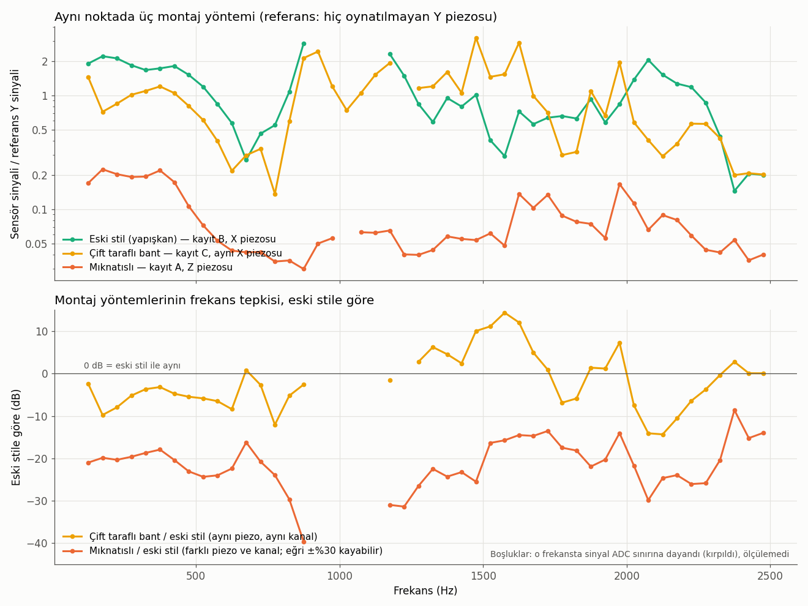
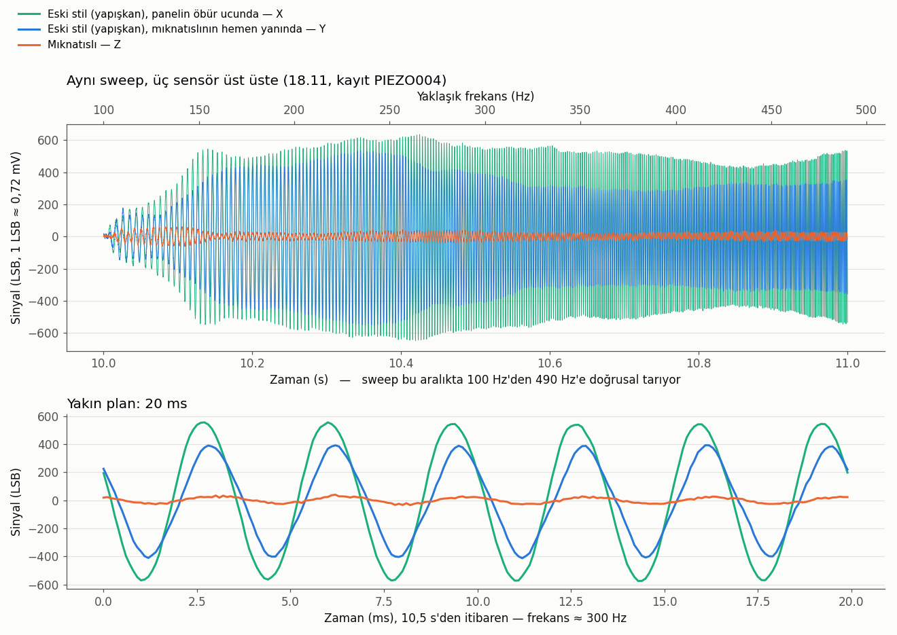
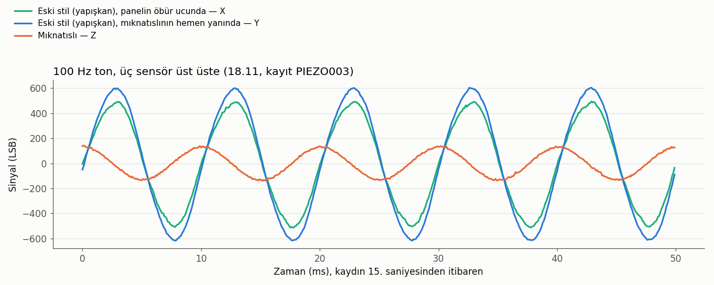
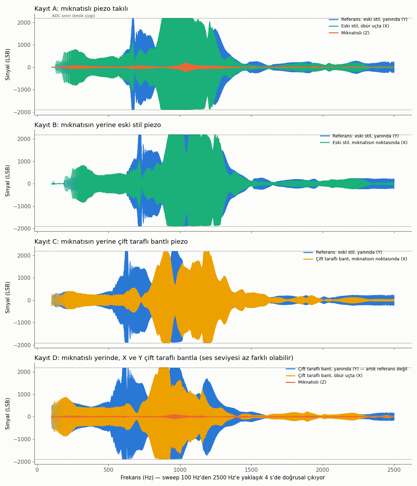

# 18.11.2026: piezo montaj karşılaştırması

Motor denemesinden önce hoparlörde üç montaj yöntemi karşılaştırıldı:

- **Eski stil:** piezo, pirinç yüzündeki eski yapışkan kalıntısıyla bastırılarak yapıştırıldı. Önceki bütün kayıtlar bu yöntemle alındı.
- **Mıknatıslı:** piezonun pirinç yüzü, ortadan bir damla süper yapıştırıcıyla küçük bir mıknatısa yapıştırıldı. Motorda bu yöntem kullanılacak.
- **Çift taraflı bant:** yalnızca akşamki testte denendi.

Firmware ve analog devre 16.11'deki gibi: SPI kapısı açık, TL074CN, 9 V pil, Rf 8 MΩ ∥ Cf 470 pF. Güncel proje [16.11 klasöründe](../16%2011%2026%20SPI%20kap%C4%B1s%C4%B1%20g%C3%BCncellemesi/).

## Düzen

Hoparlör yan yatırıldı. Piezolar arka panelde.

| Kanal | Pin | Yeri |
|---|---|---|
| Z | PA2 | Mıknatısın tutunduğu nokta (mıknatıs, hoparlörün içindeki sürücüye tutunuyor) |
| Y | PA1 | Mıknatıslının hemen yanı. Eski stil. **Referans:** son kayıt dışında hiç oynatılmadı. |
| X | PA3 | Öğleden sonra panelin öbür ucunda; akşam mıknatısın noktasına taşındı |

Y'nin yeri ve montajı değişmediği için, her kayıtta hoparlörün o anki titreşimini Y gösteriyor. Öteki kanallar Y'ye bölünerek karşılaştırıldı. Böylece hoparlörün frekansa göre değişen sesi ve ses seviyesi farkları sonuçtan çıkıyor.

## Sonuç

**Mıknatıslı piezo, aynı noktadaki eski stil piezoya göre 100–2500 Hz aralığının tamamında daha az sinyal veriyor: çoğu frekansta 5–35 kat (−14 ile −31 dB), 875 Hz civarındaki tek bir noktada yaklaşık 100 kat. Rezonans tepesi yok. Sinyali temiz; tıkırtı ya da bozulma görülmedi.**

Çift taraflı bant, eski stile göre 600 Hz'in altında 1,5–3 kat sinyal kaybettiriyor. Daha yüksek frekansta tutarlı bir kayıp ya da kazanç yok.

**Karar:** Motorda mıknatıslı montajla devam edilecek. Hoparlörün plastik paneli eğilip esniyor. Doğrudan yapışık piezo bu eğilmeyi birebir alıyor. Mıknatısa yapışık disk ise yalnızca kendi ataletiyle titreşiyor. Motorun döküm gövdesi rijit olduğu için fark orada daha küçük olabilir; bu bir tahmin, ölçülmedi. Sinyal motorda zayıf kalırsa kazanç artırılacak.

## 1. Öğleden sonra: 100–500 Hz sweep ve 100 Hz ton

Klasör: [1_hoparlor_100-500Hz/](1_hoparlor_100-500Hz/)

- Z mıknatıslı; Y ve X eski stil (X panelin öbür ucunda).
- Kayıtlar: `montaj100hzPIEZO003.BIN` (100 Hz ton, 29,9 s) ve `montajswPIEZO004.BIN` (100–500 Hz sweep, 28,0 s).
- WAV dosyalarında 16.11 WAV'larıyla aynı ortak kazanç kullanıldı (1 LSB → 35,13).

| | Mıknatıslı (Z) | Eski stil, yanında (Y) | Eski stil, öbür uçta (X) |
|---|---|---|---|
| 100 Hz ton genliği | 130 LSB | 598 LSB | 486 LSB |
| Sweep, 150–490 Hz | 17–33 LSB | 300–520 LSB | 440–620 LSB |

16.11'de üç piezo da eski stilken aynı kanallar neredeyse aynı genliği veriyordu (100 Hz'de Z/Y = 1,14). Bu yüzden aradaki fark kanallardan değil, montajdan geliyor.

Diğer grafikler:
- `3_frekansa_gore_genlik.png`: frekansa göre genlik, 16.11 referansıyla birlikte.
- `4_cizirti_kontrolu.png`: hoparlör sessizken bir veri bloğunun ilk 120 ms'si. İlk ~45 ms'de kart SD'ye yazıyor. SPI kapısı kapalıyken bu aralıkta sıçramalar oluyordu. Kapı açıkken olmuyor; bugünkü kayıtlarda da olmuyor.

## 2. Akşam: 100–2500 Hz sweep

Klasör: [2_hoparlor_100-2500Hz/](2_hoparlor_100-2500Hz/)

Sweep 100 Hz'den 2500 Hz'e yaklaşık 4 s'de doğrusal olarak çıkıp iniyor; her kayıtta birkaç tur var. A, B ve C kayıtlarında ses seviyesi aynı. Y'nin genliği üçünde de ±%10–20 içinde.

| Kayıt | Z (PA2) | Y (PA1) | X (PA3) |
|---|---|---|---|
| `A_miknatisli_PIEZO001` | **Mıknatıslı**, kendi noktasında | Eski stil | Eski stil, öbür uçta |
| `B_eskistil_PIEZO002` | Çıkarıldı (masada) | Eski stil | **Eski stil, mıknatısın noktasında** |
| `C_bant_PIEZO003` | Çıkarıldı (masada) | Eski stil | **Çift taraflı bant, aynı noktada** |
| `D_bant_ve_miknatis_PIEZO004` | Mıknatıslı, kendi noktasında | **Çift taraflı bant** | **Çift taraflı bant**, öbür uçta |

- **Mıknatısın tepkisi:** A'daki Z/Y oranı, B'deki X/Y oranına bölündü. İki eğride de nokta aynı. Ancak piezo ve kanal farklı olduğu için eğri bütünüyle yaklaşık ±%30 kayabilir; eğrinin şekli değişmez.
- **Bandın tepkisi:** C'deki X/Y oranı, B'deki X/Y oranına bölündü. Nokta, piezo ve kanal aynı.
- **1 kHz üstündeki dalgalanma:** Bandın 1 kHz üstündeki ±10 dB'lik dalgalanması büyük olasılıkla piezonun B ile C arasında birkaç milimetre farklı yere konmasından geliyor. Panel bu frekanslarda noktadan noktaya çok farklı titreşiyor. Bu ayrıca sınanmadı.
- **D kaydı yorumlanamadı:** Referans Y de banda geçtiği için D'de referans kalmadı. Ses seviyesi de biraz farklı olabilir. D'de mıknatıslı Z, bantlı Y'ye göre 600 Hz'in altında yaklaşık 27 kat, 1300–2500 Hz'de yaklaşık 10 kat az sinyal veriyor.
- **Kırpılma:** X ve Y'de 600–1200 Hz civarında sinyal ADC sınırına dayandı. Bu anlar analizden çıkarıldı; grafikteki boşluklar bundan. Mıknatıslı Z hiç kırpılmadı.
- **WAV dosyaları:** `*_X.wav`, `*_Y.wav`, `*_Z.wav`; 10 kHz, 16 bit. Bu dört kayıt için ortak kazanç kullanıldı (1 LSB → 14,58). Kayıtlar 100–500 Hz testinden daha yüksek seste alındığı için kazanç orada kullanılandan farklı. Bu klasör içindeki seslerin seviyeleri birbiriyle karşılaştırılabilir. Mıknatıslı Z'nin sesi bu yüzden çok kısık. B ve C'deki Z dosyaları, masada duran piezonun gürültüsü.

## Sayıları yeniden üretme

- **Akşam testi:** `2_hoparlor_100-2500Hz/analiz/` içinde önce `python -I frek_tepki.py`, sonra `python -I frek_grafik.py` çalıştırılır. Betikler yalnızca numpy ve matplotlib kullanıyor; kayıtları bu klasörün `kayitlar/` klasöründen okuyor.
- **Öğleden sonra testi:** 16.11 klasöründeki `Piezo_KaraKutu_2026-11-16.zip` içinden `analiz/analiz.py` dosyası `1_hoparlor_100-500Hz/analiz/` klasörüne kopyalanır. Sonra `python -I montaj_analiz.py` ve `python -I cizirti_kontrol.py` çalıştırılır.
