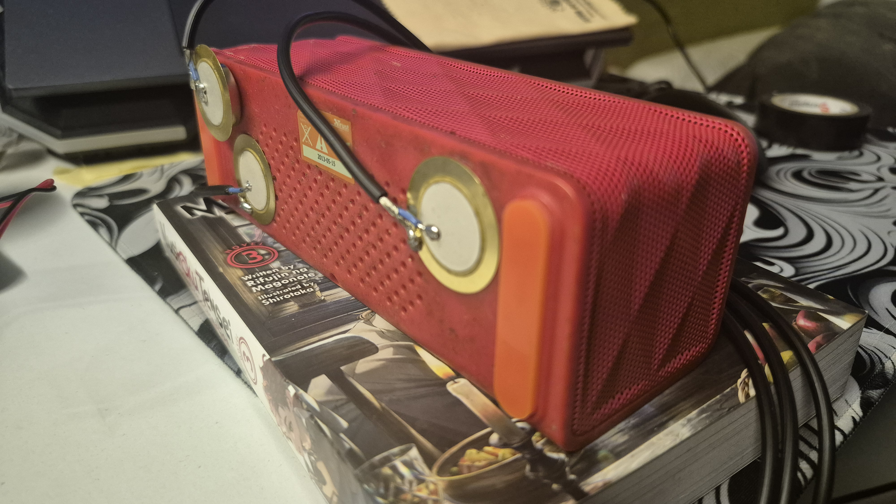
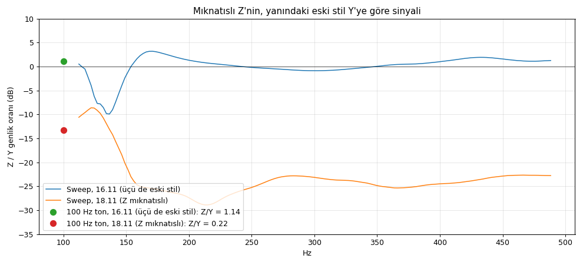
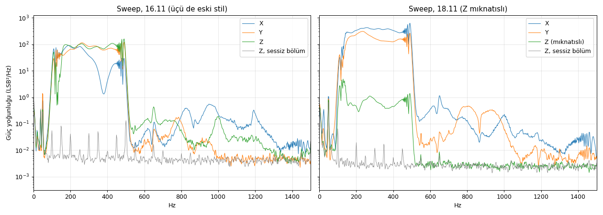
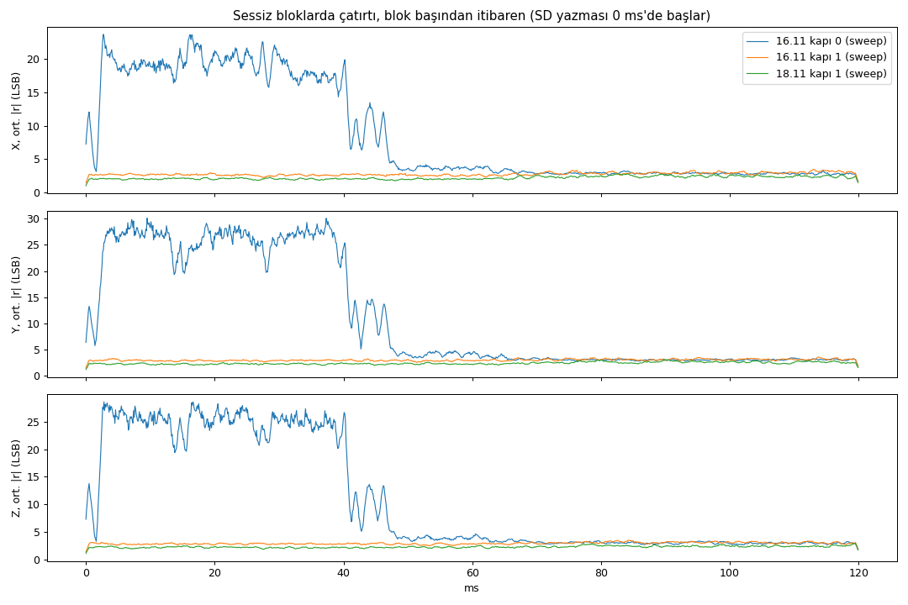

# 18.11.2026: piezo montaj karşılaştırması (mıknatıs ve eski stil)

Bu klasörde motor denemesinden önce hoparlörde yapılan montaj testi var. Soru şu: piezoyu mıknatısla tutturmak, yüzeye doğrudan yapıştırmaya göre ne kadar sinyal kaybettiriyor?

Firmware ve AFE 16.11'deki gibi: SPI kapısı açık (1), TL074CN, 9 V pil, Rf 8 MΩ ∥ Cf 470 pF. Kod değişmediği için bu klasörde proje zip'i yok. Güncel proje [16.11 klasöründe](../16%2011%2026%20SPI%20kap%C4%B1s%C4%B1%20g%C3%BCncellemesi/).

## İçerik

| Dosya | Açıklama |
|---|---|
| [kayitlar/](kayitlar/) | 2 ham kayıt (`.BIN`) ve her kayıt ve eksen için WAV |
| [grafikler/](grafikler/) | Spektrum, Z/Y oranı ve çatırtı kontrolü |
| [fotograflar/](fotograflar/) | Hoparlördeki montaj düzeni ve genel düzenek |
| [analiz/](analiz/) | Analiz betikleri ve çıktısı |

## Test düzeni

- Hoparlör yan yatırıldı. Üç blendajlı piezo arka panelde.
- **Z (PA2): mıknatıslı.** Piezonun pirinç yüzü küçük bir mıknatısa ortadan bir damla süper yapıştırıcıyla yapıştırıldı. Mıknatıs plastiğe yapışmadığı için hoparlörün içindeki sürücünün mıknatısına ya da çelik parçasına tutunuyor.
- **Y (PA1): eski stil**, mıknatıslı piezonun hemen yanında. Eski stil, önceki kayıtlarda olduğu gibi eski yapışkan kalıntısıyla tutunma anlamına geliyor.
- **X (PA3): eski stil**, panelin öbür ucunda.
- Çift taraflı bant da denenecekti, ama eldeki bant çok eski olduğu için vazgeçildi.

Z ile Y yan yana durduğu için aynı bölgenin titreşimini alıyorlar. Kanalların kendi duyarlılık farkını ayıklamak için Z/Y oranı 16.11 kapı 1 kayıtlarıyla (`gate1swPIEZO003`, `gate1100hzPIEZO004`) karşılaştırıldı; o kayıtlarda üç piezo da eski stildi.

## Kayıtlar

| Dosya | Sinyal | Süre |
|---|---|---|
| `montaj100hzPIEZO003.BIN` | ~8 s sessiz + ~13 s 100 Hz + ~8 s sessiz | 29,9 s |
| `montajswPIEZO004.BIN` | ~10 s sessiz + ~8 s sweep (~100–500 Hz) + ~10 s sessiz | 28,0 s |

- Kart dosyaları `PIEZO003.BIN` ve `PIEZO004.BIN` adıyla yazdı. 16.11 kayıtlarıyla karışmasın diye yeniden adlandırıldı.
- **WAV dosyaları:** `*_X.wav`, `*_Y.wav`, `*_Z.wav`; 10 kHz, 16 bit. 16.11 WAV'larıyla aynı ortak kazanç kullanıldı (1 LSB → 35,13). Bu yüzden iki klasördeki seslerin seviyeleri karşılaştırılabilir.

## Sonuç

**Mıknatıslı piezo hoparlörde belirgin biçimde daha az sinyal veriyor, ama sinyali temiz.**

| Ölçüt | 16.11, Z eski stil | 18.11, Z mıknatıslı | Fark |
|---|---|---|---|
| 100 Hz genliği, Z / Y (LSB) | 663 / 583 → oran 1,14 | 130 / 598 → oran 0,22 | yaklaşık −14 dB (5 kat) |
| Sweep, 150–400 Hz bant RMS oranı Z/Y | 1,04 | 0,056 | yaklaşık −25 dB (18 kat) |
| Sweep, 400–1000 Hz bant RMS oranı Z/Y | 1,19 | 0,070 | yaklaşık −25 dB |

- **Kayıp frekansla artıyor:** 100 Hz'de yaklaşık 5 kat, 150–500 Hz'de yaklaşık 18 kat. Sweep aralığında mıknatısa özgü bir rezonans tepesi görülmedi. 500 Hz'in üstü uyarılmadığı için orası hakkında sonuç çıkarılamaz.
- **Tıkırtı yok:** 100 Hz tonunda Z'nin harmonik bozulması %0,8; eski stil kanallarda %3–4,6. Mıknatıs gevşek oturup vurmuyor.
- **Gürültü tabanı aynı:** Üç kanalda da sessiz bölüm yaklaşık 2 LSB. Kayıp doğrudan sinyal/gürültü oranına yansıyor. Z'de 100 Hz'de yaklaşık 40 dB pay kaldı, sweep'te yaklaşık 20 dB.
- **Konum etkisi küçük:** Y'nin 100 Hz genliği 16.11 ile aynı (598 ve 583 LSB). Öbür uca taşınan X'te genlik 794'ten 486'ya düştü; bu yaklaşık −4 dB. Mıknatısın etkisi bunun çok üstünde.

**Yorum.** Hoparlörün plastik paneli sesle eğilip esniyor. Doğrudan yapışık piezo bu eğilmeyi birebir alıyor. Mıknatısa yapışık disk ise yüzeyin eğilmesini almıyor, yalnızca kendi ataletiyle titreşiyor. Motorun döküm gövdesi rijit olduğu için orada fark daha küçük olabilir; bu bir tahmin, ölçülmedi.

**Karar.** Motorda mıknatıslı montajla devam edilecek. İlk motor kaydı mevcut devreyle alınacak. Sinyal zayıf kalırsa kazanç artırılacak. Dikkat: Cf tek başına küçültülürse alt köşe frekansı yükselir; şu an yaklaşık 42 Hz. Bu yüzden Rf aynı oranda büyütülmeli.

## Çatırtı kontrolü

Kapı 1 bu kayıtlarda da temiz. Sessiz bloklarda SD yazma penceresinin ortalaması 2,1–2,4 LSB; aynı bloğun sakin kısmı 2,4–2,6 LSB. 16.11'de kapı 0 iken pencere 9–14 LSB'ydi.

## Sayıları yeniden üretme

1. 16.11 klasöründeki `Piezo_KaraKutu_2026-11-16.zip` içinden `analiz/analiz.py` dosyasını bu klasörün `analiz/` klasörüne kopyalayın.
2. `python -I montaj_analiz.py` ve `python -I cizirti_kontrol.py` komutlarını çalıştırın. Betikler bu klasörün `kayitlar/` klasörünü ve 16.11 klasörünün `kayitlar/` klasörünü kullanır; depo düzeni korunursa başka bir ayar gerekmez.

Betiklerin önceki çıktısı `analiz/analiz_ciktisi.txt` dosyasında.
