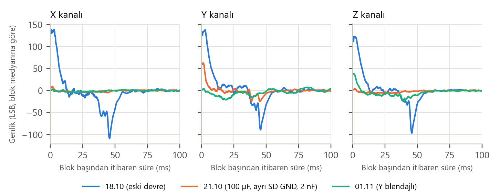
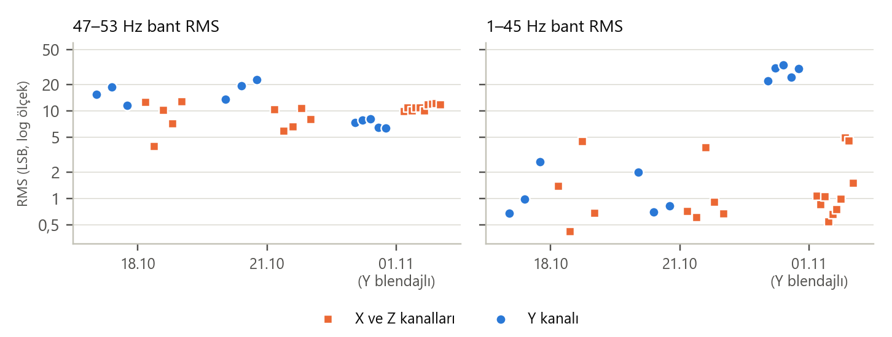

# 2. Dönem Geliştirmeleri: Üç Eksenli Piezo Titreşim Kara Kutusu (STM32F407)

Asenkron motorlarda titreşim analizi ve arıza teşhisi için kaydedici. Üç piezo kanalı kanal başına 10 kHz ile örneklenir, ham ikili veri olarak SPI üzerinden microSD karta yazılır.

EEM 413 bitirme projesi, Eskişehir Teknik Üniversitesi. Hazırlayan: Eren Özşen. Danışman: Emin Germen.

**Durum (16.11.2026):** Kaydedici çalışıyor. SD yazması sırasında oluşan çatırtı firmware'deki SPI kapısıyla giderildi. Üç kanal da blendajlı kabloya geçti. Hoparlörle masa testleri sürüyor; henüz motordan veri alınmadı ve arıza teşhisi kısmı başlamadı.

## Klasör düzeni

| Yer | İçerik |
|---|---|
| [16 11 26 SPI kapısı güncellemesi/](<16 11 26 SPI kapısı güncellemesi/>) | **Güncel sürüm:** firmware zip'i (SPI kapısı açık), kapı testi kayıtları, grafikleri ve sonuçları |
| [Piezo_KaraKutu_2026-11-03.zip](Piezo_KaraKutu_2026-11-03.zip) | Önceki sürüm: firmware projesi (SPI kapısı yok), belgeler ve analiz betiği |
| [VsCodeda_Piezo_Ornek_ve_Analiz/](VsCodeda_Piezo_Ornek_ve_Analiz/) | Kayıtlar, WAV dosyaları, okuma betikleri ve açıklamaları |
| [AFE_DEGISIKLIKLERI.md](AFE_DEGISIKLIKLERI.md) | Analog ön katta yapılan değişiklikler ve ölçümler |
| [grafikler/](grafikler/) | Kayıtlardan üretilen karşılaştırma grafikleri |
| [fotograflar/](fotograflar/) | Devre ve deney düzeneği fotoğrafları |

## Sistem

```
Piezo X/Y/Z → yük yükselteci → ADC1 (PA3, PA1, PA2) → DMA ping-pong tampon → SPI1 → microSD
                                  ↑
                         TIM3, 10 kHz tetik
```

- **Mikrodenetleyici:** STM32F407G-DISC1
- **Örnekleme:** TIM3 ile tetiklenen 3 kanallı ADC taraması, kanal başına 10 kHz, 144 çevrim örnekleme süresi
- **Tampon:** 2 × 4096 çerçeve (48 KB). Her yarı 409,6 ms'de dolar ve SD karta yazılır.
- **Dosya biçimi:** `PIEZOnnn.BIN`, little-endian `uint16`, sıralama `X,Y,Z,X,Y,Z…`
- **Gerilime çevirme:** `V = kod · 2,936 / 4095`. Kartta VDDA = VDD ≈ 2,936 V ölçüldü, 3,3 V değil.
- **Pinler:** X = PA3, Y = PA1, Z = PA2. SD: SCK PA5, MISO PA6, MOSI PA7, CS PA4. PA0 = kaydı durdur/başlat düğmesi.

## Bu dönemde neler değişti

### Firmware (Ekim 2026)

Ayrıntılar zip'teki `Docs/Uc_Piezolu_SD_Kaydedici_Incelemesi.pdf` dosyasında.

- Sessiz blok kaybına yol açan bayrak yarışı giderildi, kayıp bloklar `overrun_count` ile sayılıyor.
- Tampon 48 KB oldu, `f_sync` yaklaşık 0,8 s'de bir çalışıyor.
- Yazma hatası, kart dolması ve ADC durması algılanıyor.
- Mavi düğmeyle kayıt durdurulup başlatılabiliyor, her kayıt yeni bir `PIEZOnnn.BIN` dosyasına yazılıyor.
- SD kart 328 kHz'te başlatılıp 10,5 MHz'e geçiyor.
- X kanalı PA0'dan PA3'e taşındı.

### Firmware (Kasım 2026): SPI kapısı

Bu değişiklik danışman Emin Germen'den geldi (03.11.2026). Yalnızca `defines.h`, `tm_stm32_spi.h` ve `tm_stm32_spi.c` dosyaları değişti.

- SPI1, ADC'nin 3 kanallı taraması sürerken (~22 µs) bayt göndermiyor. TIM3 mikrosaniye sayıyor ve bayt yalnızca sayaç 25–97 µs aralığındayken başlıyor. Böylece SPI saat hattı (SCK) ADC örnekleme anında sessiz kalıyor.
- Özellik `defines.h` içindeki `TM_SPI1_ADC_GATE` ile açılıp kapatılıyor. Zip'teki projede açık (1).
- TIM3 durduğunda, yani SD kart bağlanırken ve dosya kapatılırken, kapı devre dışı kalıyor.

### Donanım ve analiz (18.10 – 03.11.2026)

Devre ayrıntıları [AFE_DEGISIKLIKLERI.md](AFE_DEGISIKLIKLERI.md) dosyasında.

1. Kayıtlardaki "spike" seslerinin kaynağı SD yazmaları olarak belirlendi. Bozulma, yazmanın başladığı her bloğun ilk ~40 ms'inde görülüyor.
2. Veri kaybı olmadığı doğrulandı: 100 Hz tonun fazı blok sınırlarında sürekli kaldı. Sapma 0,08 rad'ın altındaydı, bir blok kaybolsaydı yaklaşık 0,25 rad atlama görülürdü.
3. Ön kat kapasitörleri ve topraklama düzenlendi. SD yazmasının yarattığı yavaş darbe X ve Z kanallarında yaklaşık 10 kat azaldı.
4. Y kanalına blendajlı kablo takıldı. 50 Hz bandı yaklaşık 2–3 kat düştü, ancak düşük frekans gürültüsü arttı. Ayrıntılar [01.11 kayıtlarının açıklamasında](<VsCodeda_Piezo_Ornek_ve_Analiz/01 11 26 blendajlı piezo Y ekseni/README.md>).
5. Blendajlı kablo X ve Z piezolarına da lehimlendi.

### SPI kapısı testi ve üç blendajlı piezo (16.11.2026)

Ayrıntılar [16.11 güncellemesinin açıklamasında](<16 11 26 SPI kapısı güncellemesi/README.md>).

1. Üç piezo da blendajlı kabloyla aynı hoparlöre bağlandı. Breadboard'a giden açık giriş telleri 2–3 cm'ye kısaltıldı.
2. Aynı düzende sırayla kapı kapalı, kapı açık ve yine kapı kapalı kayıt alındı.
3. **Kapı açıkken çatırtı tamamen kayboldu.** Yazma penceresindeki çatırtı, bloğun sakin bölümüyle aynı seviyeye indi (yaklaşık 3 LSB). Sessiz bölümdeki toplam gürültü yarıdan fazla düştü. Veri kaybı olmadı.
4. Çatırtının kaynağı, SPI saat kenarlarının ADC örnekleme anına denk gelmesiymiş. SD kartın yazma akımı değil.


## Ölçüm sonuçları

Sessiz bloklarda, kayıtlardan hesaplanmıştır. 1 LSB ≈ 0,717 mV. 16.11 sütunlarında "kapı 0" kapının kapalı, "kapı 1" açık olduğu kayıtları gösterir.

| Metrik | Kanal | 18.10 | 21.10 | 01.11 | 16.11 kapı 0 | 16.11 kapı 1 |
|---|---|---|---|---|---|---|
| SD yavaş darbe, tepe-tepe (LSB) | X | 154–248 | 14–24 | zincire bağlı* | 7–11 | **5** |
| | Y | 149–228 | 64–88 | 18–50 | 7–12 | **4–5** |
| | Z | 217–540 | 2–15 | zincire bağlı* | 8–11 | **4–5** |
| Tek örnekli çatırtı, yazma penceresi ortalaması (LSB) | X | 30–36 | 18–21 | 17–20 | 15–20 | **2,6–2,7** |
| | Y | 13–19 | 19–24 | 14–17 | 20–24 | **2,9–3,0** |
| | Z | 12–15** | 13–22 | 16–19 | 21–25 | **2,9** |
| 47–53 Hz bant RMS (LSB) | Y | 12–19 | 13–23 | 6–8 | 2,3–2,7 | 2,4–2,5 |
| 1–45 Hz bant RMS (LSB) | Y | 0,7–2,6 | 0,7–2,0 | **22–34** | 0,7–0,8 | 0,5–0,7 |

\* 01.11'de X ve Z kabloları bazı kayıtlarda çaprazlandı. Darbe kanalı değil kablo zincirini izledi: hoparlördeki zincirde 8–16, klavyedeki zincirde 52–68 LSB.
\*\* 18.10 sweep kaydı hariç. O kayıtta Z kanalı anormaldi (119 LSB) ve kırpılma vardı.

Bloğun sakin bölümündeki çatırtı her aşamada yaklaşık 3 LSB. 16.11'de kapı açıkken yazma penceresi de bu seviyeye indi.





Bu değerler hoparlör ve klavye üzerindeki masa testlerinden alındı. Aynı aşamada birden fazla değişiklik yapıldığı için iyileşmeler tek bir nedene bağlanamaz.

## Açık sorunlar

- **Kapı açıkken SD yazma süresi ölçülmedi.** Kapı kapalıyken yazma yaklaşık 46 ms sürüyordu. Kapı her baytı bekletebildiği için açıkken bu sürenin uzaması beklenir. Ancak çatırtı kaybolunca veride yazma süresinin izi kalmadı. Testlerde blok kaybı olmadı; bloğun süresi 409,6 ms.
- **Y'deki 1–45 Hz gürültünün nedeni bilinmiyor.** 01.11'de 22–34 LSB'ye çıkmıştı, 16.11'de 0,7–0,8 LSB'ye indi. Arada kablolar, giriş telleri ve piezonun yeri aynı anda değiştiği için neden belirlenemedi.
- **Kanal duyarlılıkları farklı.** Aynı hoparlörde X, Y'den yaklaşık %35 daha büyük sinyal veriyor. Olası nedenler piezonun konumu ya da kapasitansı.
- **TL074 çalışma noktası.** Kanal çıkışları bias'ın ~120 mV altında (1,35 V). Giriş ortak mod sınırı bir hipotez olarak duruyor. Kesin sınama MCP6004'e geçiş olacak.
- **Bir kayıtta Z kanalı dondu.** `PIEZOkötülehimX.BIN` dosyasında Z bazı aralıklarda 3093 LSB'de kaldı. Sonraki kayıtlarda görülmedi, nedeni bilinmiyor.
- **Bilinen firmware hatası.** `fatfs_sd.c:320` satırında `TM_DELAY_Time2()` önünde `!` eksik. SDv1/MMC kartları (≤2 GB) etkiler, SDHC kartları etkilemez. Düzeltilmedi.
- **Dosya tarihleri sabit.** Kartta RTC kullanılmıyor. En yeni kaydı tarihinden değil numarasından anlayın.

## Sıradaki adımlar

1. Motordan ön deneme (mıknatıslı montaj)
2. MCP6004'e geçiş ve DC kontrolü
3. Kalıcı montaj, sağlam ve arızalı motordan saha verisi
4. STFT/spektrogram ve arıza teşhisi

## Zip'teki projeyi kullanma

**Firmware:** Güncel zip `16 11 26 SPI kapısı güncellemesi/Piezo_KaraKutu_2026-11-16.zip`. STM32CubeIDE'de *File → Import → Existing Projects into Workspace* ile `Project_6_uc_Eksen_Piezo_wSPI_eg` klasörünü açıp derleyin. `Debug/` klasörü zip'te yok, CubeIDE derlerken yeniden oluşturur.

**Sayıları yeniden üretme:** Kayıtlar zip'te değil, [VsCodeda_Piezo_Ornek_ve_Analiz/](VsCodeda_Piezo_Ornek_ve_Analiz/) klasöründe.

- 18.10–01.11 tablosundaki değerler `analiz/analiz.py` ile üretildi. Çalıştırmadan önce betikteki `KOK` yolunu bu klasöre göre değiştirin.
- 16.11 değerleri güncel zip'teki `analiz/kapi_analiz.py` ve `analiz/kapi_sayim.py` ile üretildi. Bu iki betik `analiz.py`'deki fonksiyonları kullanır. Kayıtları `16 11 26 SPI kapısı güncellemesi/kayitlar/` klasöründe arar.

**Eski rapor:** Mayıs 2026 raporu (`Docs/`) eski tasarımı anlatır: TL084, 3,3 V ve PA0 gibi bilgiler güncel değildir.

## Üçüncü taraf kod

ST HAL/CMSIS ve USB Host kütüphaneleri, Tilen Majerle'nin `tm_stm32` kütüphaneleri ve FatFs kendi lisanslarıyla dosyaların içinde yer alır.
